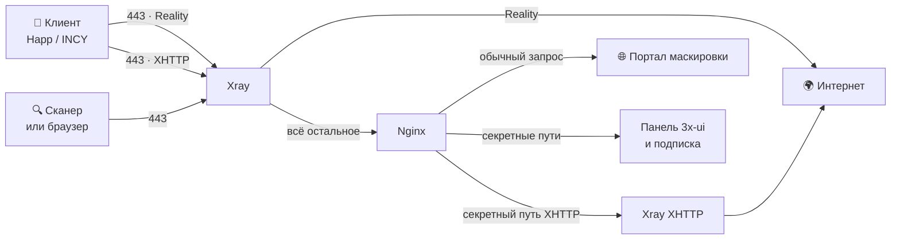

<div align="center">

# 🚀 SuperTurbo 3X-UI

### Собственная VPN-нода на зарубежном VPS — одной командой

Устанавливает 3x-ui, настраивает **VLESS Reality** и **XHTTP** за единым портом 443,<br>
закрывает сервер от сканеров и выдаёт готовую подписку для **Happ** и **INCY**.

[](https://github.com/vaalaav/SuperTurbo3XUI-2/actions/workflows/ci.yml)


[](LICENSE)

[Быстрый старт](#-быстрый-старт) •
[Возможности](#-возможности) •
[Как это работает](#-как-это-работает) •
[Управление](#-управление-нодой) •
[Документация](#-документация)

</div>

---

## ✨ Почему SuperTurbo

Ручная настройка VPN-ноды — это десятки шагов: панель, сертификаты, Nginx, маскировка, файрвол, защита SSH, правила маршрутизации. Ошибка в любом из них превращает сервер либо в заметную цель, либо в неработающий прокси.

SuperTurbo проходит весь путь за вас: задаёт несколько понятных вопросов, ставит и связывает все компоненты, **сам проверяет, что VPN действительно пропускает трафик**, и отдаёт ссылку на подписку.

<table>
<tr>
<td width="33%" valign="top">

### 🥷 Незаметность
Один открытый порт 443. Для постороннего взгляда сервер — обычный сайт с настоящим сертификатом.

</td>
<td width="33%" valign="top">

### 🛡️ Защита
Антисканер, файрвол, Fail2Ban, CrowdSec и SSH с автооткатом — сервер закрыт с первой минуты.

</td>
<td width="33%" valign="top">

### ⚡ Готово к работе
Два профиля подключения, подписка и маршрутизация для клиентов. Ничего не нужно настраивать руками.

</td>
</tr>
</table>

---

## ⚡ Быстрый старт

На чистом VPS от имени `root`:

```bash
bash <(curl -fsSL https://raw.githubusercontent.com/vaalaav/SuperTurbo3XUI-2/main/bootstrap.sh)
```

<table>
<tr>
<td align="center" width="33%"><h3>1️⃣</h3><b>Запустите</b><br><sub>одна команда на свежем сервере</sub></td>
<td align="center" width="33%"><h3>2️⃣</h3><b>Ответьте на вопросы</b><br><sub>домен, SSH, защита, портал маскировки — у каждого пункта есть рекомендованный вариант</sub></td>
<td align="center" width="33%"><h3>3️⃣</h3><b>Подключайтесь</b><br><sub>ссылка на подписку, логин панели и готовые профили — в конце установки</sub></td>
</tr>
</table>

> [!TIP]
> Перед запуском направьте A-запись домена (или поддомена) на IP сервера — установщик проверит её и выпустит сертификат Let's Encrypt.

---

## 🎯 Возможности

### 🔐 Два протокола против блокировок

| Профиль | Для чего |
|---|---|
| **VLESS + Reality + Vision** | Быстрое подключение, устойчиво работает на iOS и Android |
| **VLESS + XHTTP** | Трафик выглядит как обычные HTTPS-запросы к сайту — запасной вариант при жёсткой фильтрации |

Оба профиля работают через **один порт 443**, а клиент получает их одной подпиской.

### 🎭 Маскировка

- Сервер отвечает как полноценный многостраничный сайт: один из пяти автономных порталов (**облачное хранилище**, **статус сервисов**, **документация API**, **B2B-аналитика**, **инженерный журнал**) или ваш собственный сайт через reverse proxy.
- Каждый портал уникализируется под ваш домен (бренд, цветовая тема, подстраницы, `favicon.ico`, `robots.txt`, `sitemap.xml`, страница `404` и согласованные API-эндпоинты Nginx) — без загрузки сторонних шаблонов. Шаблон можно сменить или перегенерировать командой `my3xui mask`.
- Сертификат **Let's Encrypt** для вашего домена.
- Запросы по голому IP и с чужим доменом отклоняются ещё на этапе TLS.
- Панель управления спрятана за секретным путём и не слушает внешний интерфейс.

### 🛡️ Защита сервера

- **Антисканер на nftables** — заранее блокирует известные сети сканирования и обновляет списки каждые 6 часов.
- **UFW** — открыты только SSH, 80 и 443.
- **Fail2Ban** и опционально **CrowdSec** — от перебора паролей и ботов.
- **Безопасная смена порта SSH** с автоматическим откатом через 3 минуты, если вы не смогли подключиться; ключи для двух устройств Termius.
- **Лимит устройств на клиента** — одну подписку не раздать на десятки телефонов.
- **Исходящий трафик в РФ блокируется** — сервер не светится обращениями к российским ресурсам.

### 📱 Подписка для клиентов

- Готовая подписка для **Happ** и **INCY**, ссылки `vless://` и JSON-подписка.
- Профиль маршрутизации **«Россия — напрямую, остальной мир — через VPN»** добавляется в Happ одним нажатием.
- По желанию — зеркало файлов маршрутизации на вашем домене, чтобы клиенту не нужно было ходить за ними на GitHub.

### 🤖 Gemini через Psiphon *(опционально)*

Если Google ограничивает Gemini для страны вашего сервера, установщик поднимает выход **Psiphon** в изолированном контейнере и направляет туда только трафик Gemini. Маршрут включается, лишь когда туннель действительно работает.

### 🔄 Надёжность и обслуживание

- **Самопроверка после установки** — временный клиент подключается к серверу по выданным ссылкам и убеждается, что трафик идёт.
- **Откат при сбое** — если настройка прервётся, панель вернётся к прежней рабочей конфигурации, выданные ссылки продолжат работать.
- **Ежедневное обновление файлов маршрутизации** с проверкой целостности.
- **Повторный запуск безопасен** — ключи и ссылки клиентов сохраняются.
- **Модульность** — любой этап можно перезапустить отдельно.

---

## 🧭 Как это работает



На порту 443 работает Xray. Клиенты с ключом Reality сразу выходят в интернет. Всё остальное — XHTTP-клиенты, браузеры, сканеры — уходит в Nginx с настоящим сертификатом: XHTTP-трафик по секретному пути возвращается в Xray, а случайный посетитель видит обычный сайт.

---

## 🧩 Этапы установки

| | Модуль | Что делает |
|:-:|---|---|
| 1 | **Подготовка** | Проверка системы и домена, мастер настройки |
| 2 | **Система** | Nginx из официального репозитория, BBR, swap, защищённый DNS |
| 3 | **Безопасность** | SSH, UFW, Fail2Ban, CrowdSec, антисканер |
| 4 | **Сертификат и сайт** | Let's Encrypt и многостраничный портал маскировки |
| 5 | **3x-ui** | Панель, два профиля, клиент, подписка |
| 6 | **Gemini** | Опциональный выход через Psiphon |
| 7 | **Nginx** | Связка Reality, XHTTP, портала, панели и подписки |
| 8 | **Финал** | Утилита `my3xui`, учётные данные и самопроверка VPN |

---

## 🎛️ Управление нодой

После установки на сервере появляется утилита `my3xui` — с меню, удобным даже с телефона в Termius.

| Команда | Что делает |
|---|---|
| `my3xui` | Интерактивное меню |
| `my3xui creds` | Адрес панели, логин, пароль, подписка и ссылки |
| `my3xui audit` | Полная проверка ноды и реального подключения через VPN |
| `my3xui info` | Ресурсы сервера, версии 3x-ui и Xray |
| `my3xui security` | Состояние файрвола, Fail2Ban, CrowdSec и антисканера (и управление CrowdSec) |
| `my3xui ssh` | Порт SSH, ключи устройств, отключение входа по паролю |
| `my3xui mask` | Просмотр, переключение и перегенерация портала маскировки |
| `my3xui backup` | Резервная копия конфигурации ноды и базы 3x-ui |
| `my3xui self-update` | Обновление скриптов проекта |
| `my3xui clean` | Полное удаление с сохранением доступа по SSH |

---

## 📋 Требования

- VPS с **Ubuntu 24.04 / 26.04** или **Debian 12 / 13**, доступ `root`
- **1 ГБ RAM** достаточно: при нехватке памяти установщик добавит swap (CrowdSec рекомендуется от 1,2 ГБ)
- **Домен или поддомен** с A-записью на IP сервера
- Свободные порты **80** и **443**

---

## ✅ Проверено автоматически

Каждое изменение проходит CI на GitHub Actions: линтеры, поиск секретов, модульные тесты, проверка конфигурации Nginx и сквозные сценарии на чистых машинах — установка с нуля, обновление старой панели, откат при сбое, Psiphon и **реальный трафик через оба протокола**.

---

## 📚 Документация

- [Техническое описание](docs/TECHNICAL.md) — устройство ноды, параметры установщика, файлы маршрутизации, Psiphon, решение проблем, разработка
- [История изменений](CHANGELOG.md)

---

## ⚖️ Лицензия и ответственность

Copyright (c) 2026 vaalaav. Код проекта распространяется по лицензии [PolyForm Strict 1.0.0](LICENSE) (разрешено некоммерческое использование; распространение и модификация запрещены).

Перед использованием ознакомьтесь с лицензиями сторонних компонентов и правилами их применения в вашей юрисдикции.

Проект предоставляется «как есть». Администратор сервера самостоятельно отвечает за настройки доступа, безопасность учётных данных, соблюдение законодательства и последствия использования развёрнутой инфраструктуры.

<div align="center">
<sub>Сделано с ❤️ для тех, кто ценит свободный интернет</sub>
</div>
